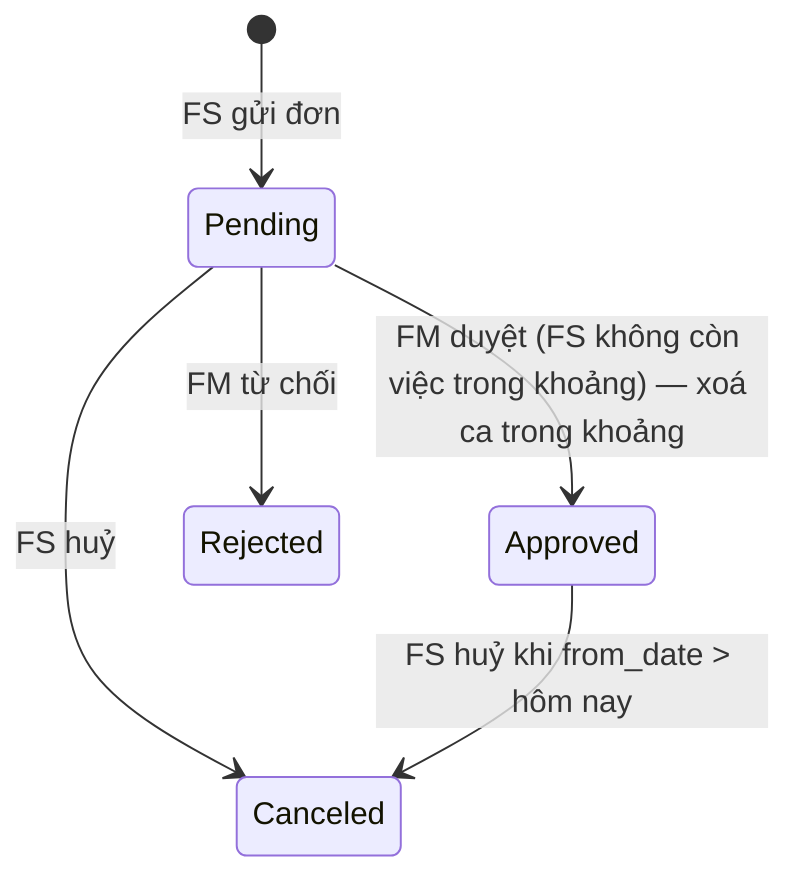

# Nhân sự (Flow 5)

Trang này là contract của các route `/api/fm/staff-shifts…`, `/api/fm/staff-leaves…`, `/api/fm/staff/{id}/profile`,
`/api/fm/reports/staff`, `/api/staff/shifts`, `/api/staff/leaves…`, `/api/staff/profile`,
`/api/bom/staff/{id}/profile`, `/api/bom/reports/staff`, `/api/admin/accounts/{id}/profile` (không có file riêng trong
`routes/`; field chi tiết ở Swagger trên `StaffingController` / `BackofficeController`).

| Phần | Code |
|---|---|
| Kiểm FS nhận được việc (ca + nghỉ phép), trạng thái ngày của FS | `staffing/application/StaffAvailability.java` |
| Ca làm việc | `staffing/application/StaffShiftService.java` |
| Nghỉ phép | `staffing/application/StaffLeaveService.java` |
| Hồ sơ nhân viên | `staffing/application/StaffProfileService.java` |
| Tra cứu chung, policy, khoá theo FS | `staffing/application/StaffDirectory.java` |
| Route | `staffing/controller/StaffingController.java`, lỗi `StaffingExceptionHandler` |
| Việc FS đang giữ (SPI) | `identity/application/StaffOpenWork.java` — bản cài ở booking (lịch hẹn), support (hỗ trợ), handover |
| Báo cáo nhân sự, headcount | `backoffice/repository/BackofficeReadRepository.staffReport`, `facility/application/FacilityAdminCommands.list` |

Module `staffing` phụ thuộc `facility`, `pricing`, `identity`, `notification`, `audit` (`application`). Booking,
tenancy, support gọi `staffing::application` khi phân công; `staffing` không phụ thuộc ngược các module đó — việc FS
đang giữ đọc qua các biến thể theo ngày của `StaffOpenWork`.

Lỗi nghiệp vụ của module (`StaffingException`): dữ liệu sai → 400, ngoài quyền → 403, không tìm thấy → 404, xung đột
→ 409. Quyền theo cơ sở dùng `Access` như mọi route khác (thiếu permission / ngoài cơ sở → 403, cơ sở không tồn tại →
404).

## Bảng dữ liệu (V32)

| Bảng | Cột chính | Ràng buộc |
|---|---|---|
| `staff_shifts` | `facility_id`, `staff_id`, `shift_date` (DATE), `start_time`, `end_time` (TIME, giờ VN), `note`, `created_by`, `created_at`, `updated_at` | `start_time < end_time`; index `(staff_id, shift_date)`, `(facility_id, shift_date)` |
| `staff_leaves` | `staff_id`, `from_date`, `to_date` (cả hai đầu), `reason`, `status` `Pending`/`Approved`/`Rejected`/`Canceled`, `reviewed_by`, `reviewed_at`, `review_note`, `created_at` | `from_date <= to_date` |
| `staff_profiles` | `account_id` (PK, FK `accounts`), `position`, `hire_date`, `id_number`, `emergency_contact_name`, `emergency_contact_phone`, `note`, `updated_by`, `updated_at` | một dòng mỗi tài khoản FS / FM |

Seed V32:
- policy `staff.shift_required = true` (`ON CONFLICT DO NOTHING`);
- ca mẫu 07:00–21:00 mỗi ngày từ `CURRENT_DATE − 7` tới `CURRENT_DATE + 60` cho mọi FS `ACTIVE` đang có trong
  `account_facility_assignments`. FS gán nhiều cơ sở thì luân phiên cơ sở theo ngày (hai ca cùng giờ ở hai cơ sở sẽ vi
  phạm luật không chồng ca). Seed dev chỉ có fs1 @ Q7 → 68 ca;
- 4 permission + 7 dòng `role_permissions` (bảng [Quyền](#quyền)).

## Ca làm việc

FM của cơ sở quản lý ca của FS được gán vào cơ sở (`staff_shift.manage`, scope FACILITY). FS xem ca của mình ở mọi cơ
sở.

| Ràng buộc | Khi vi phạm |
|---|---|
| Thiếu ngày / giờ; `startTime ≥ endTime` (ca trong một ngày); ghi chú > 500 ký tự; thiếu `facilityId` | 400 |
| FS không phải FS `ACTIVE` được gán vào cơ sở (thêm ca) | 400 "Nhân viên không phải FS của cơ sở này" |
| FS đã rời cơ sở (sửa ca) — vẫn xoá được | 409 "FS không còn thuộc cơ sở — chỉ xoá được ca này" |
| Chồng giờ với ca khác của **cùng FS cùng ngày ở bất kỳ cơ sở nào** (`start < other.end && other.start < end`; chạm mép không tính) | 409 "Ca chồng giờ với ca 07:00–21:00 ngày 14/11/2026 tại cơ sở Q7 của cùng FS" |
| Ngày rơi vào nghỉ phép đã duyệt của FS | 409 "FS đang nghỉ phép ngày … — không xếp ca được" |
| Xoá / thu hẹp / dời ca làm một lịch hẹn `Pending` đã giao cho FS tại cơ sở (đang nằm trọn trong ca cũ) không còn ca nào bao trọn | 409 liệt kê lịch: "Ca đang bao lịch đã giao cho FS: lịch check-in #12 08:00–10:00 (FM đổi FS). Đổi FS hoặc xử lý các lịch này trước khi xoá / thu hẹp ca" |
| Khoảng xem `from..to` ngược hoặc ≥ 62 ngày | 400 |

- Lịch vốn đã nằm ngoài mọi ca (vd giao khi policy tắt) không chặn thay đổi ca. Ràng buộc chặn xoá / thu hẹp áp dụng cả
  khi policy tắt.
- Mặc định danh sách: tuần hiện tại (thứ Hai → Chủ nhật, giờ VN).
- Ca ở tương lai (thời điểm bắt đầu ca sau hiện tại; sửa ca: ca cũ hoặc ca mới ở tương lai) → FS nhận một
  `STAFF_SHIFT_CHANGED` mỗi thao tác ("Ca làm việc tại Q7: đổi ca 07:00–21:00 ngày 14/11/2026 thành 08:00–17:00 ngày
  14/11/2026."). Ca trong quá khứ đổi không báo.
- Audit một bản ghi mỗi ca: `STAFF_SHIFT_CREATED` (`new_value`), `STAFF_SHIFT_UPDATED` (old/new), `STAFF_SHIFT_DELETED`
  (`old_value`) — giá trị gồm `facilityId`, `staffId`, `shiftDate`, `startTime`, `endTime`, `note`; actor = FM.

## Luật phân công theo ca / nghỉ phép

Bốn đường giao việc cho FS gọi `StaffAvailability` ngay sau `FacilityStaffQuery.isActiveStaffOf` (FS không thuộc cơ sở
vẫn là 400 như trước):

| Đường | Kiểm | 409 |
|---|---|---|
| Phân công check-in `POST /api/fm/appointments/{id}/staff` (`AppointmentService.assignStaff`) | lịch `[started_at, end_at]` | `appointmentViolation` |
| Đổi FS `PUT /api/fm/appointments/{id}/staff` (`reassignStaff`) | lịch, FS mới | `appointmentViolation` |
| Phân công trả kho `POST /api/fm/return-requests/{id}/assign` (`TenancyService.assign`) | khung giờ vừa đặt được (`ReturnAppointmentService.book`); vi phạm → rollback cả lịch vừa tạo | `appointmentViolation` |
| Giao hỗ trợ `POST /api/fm/support-requests/{id}/assign` (`SupportService.assign`) | hôm nay (yêu cầu hỗ trợ không gắn giờ) | `todayViolation` |

Thứ tự kiểm (giờ Asia/Ho_Chi_Minh):
1. FS có nghỉ phép `Approved` phủ ngày đó → 409 "FS đang nghỉ phép ngày 12/11/2026" — **luôn kiểm**, kể cả policy tắt.
2. Policy `staff.shift_required` khác `true` → cho qua.
3. Lịch hẹn: phải có ca **tại đúng cơ sở**, đúng ngày hẹn, `start_time ≤` giờ bắt đầu và `end_time ≥` giờ kết thúc →
   không có: 409 "FS không có ca làm việc tại cơ sở bao trọn giờ hẹn 08:00–10:00 ngày 12/11/2026". Ca ở cơ sở khác
   không tính.
4. Hỗ trợ: phải có ít nhất một ca tại cơ sở hôm nay → không có: 409 "FS không có ca làm việc tại cơ sở hôm nay
   (09/11/2026)".

BOM đổi `staff.shift_required` qua `PUT /api/bom/policies/staff.shift_required`; policy đang là `true`/`false` chỉ nhận
`true` hoặc `false` (khác → 400 "Policy staff.shift_required chỉ nhận true hoặc false"). Thiếu key là lỗi cấu hình seed
(`IllegalStateException`, như mọi policy).

**Tranh chấp:** mọi thay đổi ca và gửi / duyệt / huỷ nghỉ phép giữ khoá advisory ghi theo FS
(`pg_advisory_xact_lock(5101, staffId)`); lệnh phân công giữ khoá đọc (`pg_advisory_xact_lock_shared`). Duyệt nghỉ phép
/ xoá ca chạy đồng thời với FM đang phân công FS đó thì chờ FM commit rồi mới kiểm việc của FS (thấy việc vừa giao → 409);
phân công sau khi nghỉ phép được duyệt thì thấy nghỉ phép → 409.

## Nghỉ phép



| Thao tác | Ai | Luật | Hiệu ứng |
|---|---|---|---|
| Gửi `POST /api/staff/leaves` `{fromDate, toDate, reason}` | FS | `from ≤ to`, `from ≥` hôm nay, lý do bắt buộc ≤ 500 → khác 400; chồng đơn `Pending`/`Approved` của chính FS → 409 "Trùng đơn nghỉ #2 (17/11/2026 – 17/11/2026, Pending)" | `Pending`; audit `STAFF_LEAVE_REQUESTED`; FM của mọi cơ sở FS được gán (không trùng) nhận `STAFF_LEAVE_REQUESTED` |
| Huỷ `POST /api/staff/leaves/{id}/cancel` | FS chủ đơn (đơn người khác → 404) | `Pending`, hoặc `Approved` có `from_date` sau hôm nay; khác → 409 | `Canceled`; audit `STAFF_LEAVE_CANCELED`. Ca đã xoá lúc duyệt **không** khôi phục |
| Xem `GET /api/fm/staff-leaves?facilityId=&status=` | FM (`staff_leave.review` theo cơ sở) | đơn của FS **đang** gán vào cơ sở; `status` rỗng = mọi trạng thái, đơn chờ duyệt lên đầu; tối đa 200 | — |
| Duyệt `POST /api/fm/staff-leaves/{id}/approve` `{note?}` | FM phụ trách **một** cơ sở bất kỳ FS được gán (`staff_leave.review`) | đơn không `Pending` → 409; FS còn việc → 409 (bên dưới); FS không còn gán cơ sở nào → 403 | `Approved` + `reviewed_by/at`, `review_note`; xoá mọi ca của FS (mọi cơ sở) trong khoảng, mỗi ca một audit `STAFF_SHIFT_DELETED` (`reason` "Duyệt nghỉ phép #id"); audit `STAFF_LEAVE_APPROVED`; FS nhận `STAFF_LEAVE_REVIEWED` |
| Từ chối `POST /api/fm/staff-leaves/{id}/reject` `{note?}` | như duyệt | đơn không `Pending` → 409 | `Rejected`; audit `STAFF_LEAVE_REJECTED`; FS nhận `STAFF_LEAVE_REVIEWED` |

Việc chặn duyệt (`StaffOpenWork.openItemsBetween`, mọi cơ sở):

| Việc | Điều kiện | Cách gỡ chặn |
|---|---|---|
| lịch check-in / trả kho | `appointments` `Pending`, `staff_id` = FS, `date` trong khoảng nghỉ | FM đổi FS / phân công lại yêu cầu trả kho |
| yêu cầu hỗ trợ | `support_requests` `Assigned`, `assigned_staff_id` = FS (không gắn ngày — luôn chặn) | FM giao lại |

Message liệt kê tối đa 5 việc (`… và N việc khác`): "FS còn việc trong thời gian nghỉ: lịch check-in #12 ngày
17/11/2026 (FM đổi FS), yêu cầu hỗ trợ #3 (FM giao lại). Xử lý các việc này trước khi duyệt nghỉ phép". Ghi chú > 500 ký
tự → 400.

Audit đơn nghỉ: `new_value` gồm `status`, `fromDate`, `toDate` (+ `reviewNote` khi duyệt / từ chối); actor = FS khi
gửi / huỷ, FM khi duyệt / từ chối.

## Tải việc trên màn phân công

`GET /api/fm/facilities/{facilityId}/staff?date=YYYY-MM-DD` (mặc định hôm nay, giờ VN) giữ các field cũ và thêm cho mỗi
FS ([routes/booking/fm-facility-staff.md](../routes/booking/fm-facility-staff.md)):

| Field | Nghĩa |
|---|---|
| `date` | ngày đang xem |
| `shift` | ca đầu tiên của FS tại cơ sở trong ngày `{startTime, endTime}`; `null` = không có ca |
| `shifts` | mọi ca tại cơ sở trong ngày, theo giờ bắt đầu |
| `onLeave` | có nghỉ phép `Approved` phủ ngày |
| `openWork` | `{checkins, returns}` — lịch `Pending` đã giao cho FS tại cơ sở trong ngày |
| `openSupport` | yêu cầu hỗ trợ `Assigned` giao cho FS tại cơ sở (không gắn ngày) |

FE dùng để hiển thị; luật phân công vẫn do 4 route giao việc kiểm.

## Báo cáo nhân sự

`GET /api/fm/reports/staff?facilityId=&from=&to=` (FM, `facility.access` theo cơ sở) và
`GET /api/bom/reports/staff?facilityId=&from=&to=` (BOM; bỏ `facilityId` = toàn chuỗi; cơ sở không tồn tại → 400).
Mặc định tháng hiện tại (giờ VN), tối đa 366 ngày, khoảng ngược → 400. Một dòng mỗi FS:

| Field | Đếm |
|---|---|
| `completedCheckins` / `completedReturns` | `appointments` `CHECKIN` / `RETURN` `Done`, `staff_id` = FS, `arrived_at` trong khoảng |
| `handoversCompleted` | `handover_records` `COMPLETED` của lịch có `staff_id` = FS, `completed_at` trong khoảng |
| `checkoutsCompleted` | `checkout_records` `COMPLETED` của yêu cầu trả kho `assigned_staff_id` = FS, `completed_at` trong khoảng |
| `supportResolved` | `support_requests` `Resolved`, `assigned_staff_id` = FS, `resolved_at` trong khoảng |
| `shiftHours` | tổng giờ ca có `shift_date` trong khoảng (2 số lẻ) |
| `leaveDays` | số ngày nghỉ phép `Approved` rơi vào khoảng |

Có `facilityId`: FS đang gán vào cơ sở **hoặc** có lịch hẹn / ca ở cơ sở trong khoảng; mọi số liệu trừ `leaveDays` chỉ
tính tại cơ sở đó. Không có `facilityId`: mọi tài khoản role `FS` (cả `BANNED`).

Headcount: `GET /api/bom/facilities` (và mọi route trả `FacilityRow`) có `staffCount` = số FS `ACTIVE` đang gán vào cơ
sở.

## Hồ sơ nhân viên

Chỉ tài khoản role `FS` / `FM` có hồ sơ (role khác → 404 "Không tìm thấy hồ sơ nhân viên"). Chưa nhập → mọi field hồ
sơ `null`.

| Route | Ai / quyền | Trả |
|---|---|---|
| `GET` / `PUT /api/admin/accounts/{id}/profile` | ADMIN — `staff_profile.read` / `staff_profile.manage` (GLOBAL) | `ProfileView` có `idNumber` |
| `GET` / `PUT /api/bom/staff/{id}/profile` | BOM — như trên | `ProfileView` có `idNumber` |
| `GET /api/fm/staff/{id}/profile` | FM — `staff_profile.read` (FACILITY) tại một cơ sở FS được gán; chỉ tài khoản FS (khác → 404) | `ProfileSummary` — **không có** field `idNumber` |
| `GET /api/staff/profile` | FS — hồ sơ của mình | `ProfileSummary` |

`PUT` thay toàn bộ (`position` ≤ 100, `hireDate` không ở tương lai, `idNumber` chữ + số 6–20 ký tự (viết hoa),
`emergencyContactName` ≤ 100, `emergencyContactPhone` 8–20 ký tự số / `+ .-`, `note` ≤ 1000; ô rỗng = xoá) → sai 400.
Audit một bản ghi `STAFF_PROFILE_UPDATED` (`StaffProfile`, id = account id) với old/new mọi trường; `idNumber` trong
audit chỉ giữ 4 ký tự cuối (`079123456789` → `********6789`).

## Quyền

| Permission | ADMIN | BOM | FM | FS | Dùng ở |
|---|:-:|:-:|:-:|:-:|---|
| `staff_shift.manage` | | | F | | ca làm việc của cơ sở |
| `staff_leave.review` | | | F | | xem / duyệt / từ chối nghỉ phép |
| `staff_profile.read` | G | G | F | | đọc hồ sơ |
| `staff_profile.manage` | G | G | | | sửa hồ sơ |

FS đọc ca / đơn / hồ sơ của mình theo ownership (route `/api/staff/**`), không có permission.

## Thông báo

| Type | Người nhận | Khi |
|---|---|---|
| `STAFF_SHIFT_CHANGED` | FS | FM thêm / sửa / xoá ca ở tương lai của FS (một thông báo mỗi thao tác) |
| `STAFF_LEAVE_REQUESTED` | FM của các cơ sở FS được gán | FS gửi đơn nghỉ |
| `STAFF_LEAVE_REVIEWED` | FS | FM duyệt / từ chối ("Đơn nghỉ phép đã được duyệt" / "bị từ chối", kèm ghi chú) |

Gửi in-app + email như mọi notification; không gắn đơn thuê. Xoá ca lúc duyệt nghỉ phép không gửi
`STAFF_SHIFT_CHANGED`.

## Routes

| Method | Path | Ai | Mục đích |
|---|---|---|---|
| GET | `/api/fm/staff-shifts?facilityId=&from=&to=` | FM, `staff_shift.manage` | ca của cơ sở |
| POST | `/api/fm/staff-shifts` `{facilityId, staffId, shiftDate, startTime, endTime, note?}` | FM, `staff_shift.manage` | thêm ca |
| PUT | `/api/fm/staff-shifts/{id}` `{shiftDate, startTime, endTime, note?}` | FM, `staff_shift.manage` (cơ sở của ca) | sửa ca |
| DELETE | `/api/fm/staff-shifts/{id}` | FM, `staff_shift.manage` (cơ sở của ca) | xoá ca |
| GET | `/api/staff/shifts?from=&to=` | FS | ca của tôi |
| GET / POST | `/api/staff/leaves` | FS | đơn của tôi / gửi đơn |
| POST | `/api/staff/leaves/{id}/cancel` | FS chủ đơn | huỷ đơn |
| GET | `/api/fm/staff-leaves?facilityId=&status=` | FM, `staff_leave.review` | đơn của FS thuộc cơ sở |
| POST | `/api/fm/staff-leaves/{id}/approve`, `/reject` `{note?}` | FM, `staff_leave.review` | duyệt / từ chối |
| GET | `/api/fm/staff/{id}/profile` | FM, `staff_profile.read` | hồ sơ FS (không số giấy tờ) |
| GET | `/api/staff/profile` | FS | hồ sơ của tôi |
| GET / PUT | `/api/bom/staff/{id}/profile` | BOM | hồ sơ đủ / sửa |
| GET / PUT | `/api/admin/accounts/{id}/profile` | ADMIN | hồ sơ đủ / sửa |
| GET | `/api/fm/reports/staff?facilityId=&from=&to=` | FM, `facility.access` | báo cáo nhân sự cơ sở |
| GET | `/api/bom/reports/staff?facilityId=&from=&to=` | BOM | báo cáo nhân sự toàn chuỗi / một cơ sở |

## Ví dụ

Chạy trên DB mới migrate tới V32 (seed dev, fs1 = id 5 @ Q7 có ca mẫu), ngày 09/11/2026.

```bash
TOKEN_FM='<token của fm1@lemar.vn>'; TOKEN_FS='<token của fs1@lemar.vn>'; TOKEN_BOM='<token của bom1@lemar.vn>'

# 409 — thêm ca chồng giờ với ca mẫu 07:00–21:00
curl -s -X POST http://localhost:8080/api/fm/staff-shifts -H "Authorization: Bearer $TOKEN_FM" \
  -H 'Content-Type: application/json' \
  -d '{"facilityId":1,"staffId":5,"shiftDate":"2026-11-14","startTime":"20:00","endTime":"22:00"}'
# {"message":"Ca chồng giờ với ca 07:00–21:00 ngày 14/11/2026 tại cơ sở Q7 của cùng FS","timestamp":"2026-11-09T15:23:04.701494500Z"}

# 200 — thu hẹp ca mẫu #13 thành 08:00–17:00 (FS nhận STAFF_SHIFT_CHANGED)
curl -s -X PUT http://localhost:8080/api/fm/staff-shifts/13 -H "Authorization: Bearer $TOKEN_FM" \
  -H 'Content-Type: application/json' \
  -d '{"shiftDate":"2026-11-14","startTime":"08:00","endTime":"17:00","note":"Ca hành chính"}'
# {"message":"Đã cập nhật ca làm việc","data":{"id":13,"facilityId":1,"facilityCode":"Q7","staffId":5,"staffName":"FS Quận 7","staffEmail":"fs1@lemar.vn","shiftDate":"2026-11-14","startTime":"08:00","endTime":"17:00","note":"Ca hành chính","updatedAt":"2026-11-09T15:23:41.244333Z"}}

# 403 — fm2 (cơ sở TD) xem ca của Q7
# {"message":"Bạn không được gán vào cơ sở này","timestamp":"2026-11-09T15:23:04.952019900Z"}

# FS gửi đơn nghỉ 17/11; gửi lại cùng ngày → 409
curl -s -X POST http://localhost:8080/api/staff/leaves -H "Authorization: Bearer $TOKEN_FS" \
  -H 'Content-Type: application/json' -d '{"fromDate":"2026-11-17","toDate":"2026-11-17","reason":"Việc gia đình"}'
# {"message":"Đã gửi đơn nghỉ phép","data":{"id":2,"staffId":5,"staffName":"FS Quận 7","staffEmail":"fs1@lemar.vn","fromDate":"2026-11-17","toDate":"2026-11-17","reason":"Việc gia đình","status":"Pending","reviewedBy":null,"reviewedByEmail":null,"reviewedAt":null,"reviewNote":null,"createdAt":"2026-11-09T15:23:41.365258Z","cancelable":true}}
# {"message":"Trùng đơn nghỉ #2 (17/11/2026 – 17/11/2026, Pending)","timestamp":"2026-11-09T15:23:41.407793900Z"}

# FM duyệt — ca mẫu ngày 17/11 bị xoá
curl -s -X POST http://localhost:8080/api/fm/staff-leaves/2/approve -H "Authorization: Bearer $TOKEN_FM" \
  -H 'Content-Type: application/json' -d '{"note":"Đồng ý"}'
# {"message":"Đã duyệt đơn nghỉ phép","data":{"id":2,"staffId":5,"staffName":"FS Quận 7","staffEmail":"fs1@lemar.vn","fromDate":"2026-11-17","toDate":"2026-11-17","reason":"Việc gia đình","status":"Approved","reviewedBy":3,"reviewedByEmail":"fm1@lemar.vn","reviewedAt":"2026-11-09T15:23:41.416725Z","reviewNote":"Đồng ý","createdAt":"2026-11-09T15:23:41.365258Z","cancelable":true}}

curl -s 'http://localhost:8080/api/fm/facilities/1/staff?date=2026-11-17' -H "Authorization: Bearer $TOKEN_FM"
# {"message":"Lấy danh sách nhân viên cơ sở thành công","data":[{"id":5,"name":"FS Quận 7","email":"fs1@lemar.vn","phone":null,"assignedAt":"2026-11-09T15:22:06.388716Z","date":"2026-11-17","shift":null,"shifts":[],"onLeave":true,"openWork":{"checkins":0,"returns":0},"openSupport":0}]}

# BOM sửa hồ sơ (có số giấy tờ); FM đọc lại — không có idNumber
curl -s -X PUT http://localhost:8080/api/bom/staff/5/profile -H "Authorization: Bearer $TOKEN_BOM" \
  -H 'Content-Type: application/json' \
  -d '{"position":"Nhân viên kho","hireDate":"2025-03-01","idNumber":"079123456789","emergencyContactName":"Nguyễn Văn A","emergencyContactPhone":"0901234567"}'
# {"message":"Đã cập nhật hồ sơ nhân viên","data":{"accountId":5,"email":"fs1@lemar.vn","name":"FS Quận 7","phone":null,"role":"FS","status":"ACTIVE","position":"Nhân viên kho","hireDate":"2025-03-01","idNumber":"079123456789","emergencyContactName":"Nguyễn Văn A","emergencyContactPhone":"0901234567","note":null,"updatedAt":"2026-11-09T15:23:41.495338Z"}}
curl -s http://localhost:8080/api/fm/staff/5/profile -H "Authorization: Bearer $TOKEN_FM"
# {"message":"Hồ sơ nhân viên","data":{"accountId":5,"email":"fs1@lemar.vn","name":"FS Quận 7","phone":null,"role":"FS","status":"ACTIVE","position":"Nhân viên kho","hireDate":"2025-03-01","emergencyContactName":"Nguyễn Văn A","emergencyContactPhone":"0901234567","note":null,"updatedAt":"2026-11-09T15:23:41.495338Z"}}

# Báo cáo nhân sự tháng hiện tại (trước khi sửa ca / duyệt nghỉ)
curl -s 'http://localhost:8080/api/fm/reports/staff?facilityId=1' -H "Authorization: Bearer $TOKEN_FM"
# {"message":"Báo cáo nhân sự","data":{"from":"2026-11-01","to":"2026-11-30","facilityId":1,"rows":[{"staffId":5,"name":"FS Quận 7","email":"fs1@lemar.vn","status":"ACTIVE","completedCheckins":0,"completedReturns":0,"handoversCompleted":0,"checkoutsCompleted":0,"supportResolved":0,"shiftHours":406.00,"leaveDays":0}]}}

# 400 — policy boolean
curl -s -X PUT http://localhost:8080/api/bom/policies/staff.shift_required -H "Authorization: Bearer $TOKEN_BOM" \
  -H 'Content-Type: application/json' -d '{"value":"yes"}'
# {"message":"Policy staff.shift_required chỉ nhận true hoặc false","timestamp":"2026-11-09T15:23:05.934794500Z"}
```

`audit_logs` sau các lệnh trên (rút gọn): `STAFF_SHIFT_UPDATED | StaffShift | 13 | {"startTime": "07:00", "endTime":
"21:00", "note": "Ca mẫu", …} → {"startTime": "08:00", "endTime": "17:00", "note": "Ca hành chính", …}`;
`STAFF_SHIFT_DELETED | StaffShift | 16 | … | reason "Duyệt nghỉ phép #2"`; `STAFF_LEAVE_APPROVED | StaffLeave | 2 |
{"status": "Pending"} → {"status": "Approved", "reviewNote": "Đồng ý", …}`; `STAFF_PROFILE_UPDATED | StaffProfile | 5 |
… → {"idNumber": "********6789", …}`.

## Test

`staffing/StaffingIntegrationTest.java` (Postgres, policy bật): chồng ca giữa cơ sở, nghỉ phép chặn xếp ca, xoá / thu
hẹp / dời ca dưới lịch đã giao, 409 phân công (không ca / ca không bao trọn / ca ở cơ sở khác / nghỉ phép / policy tắt)
ở cả 4 đường, duyệt nghỉ phép bị chặn bởi việc mở và xoá ca, quyền FM theo cơ sở, hiển thị `idNumber` theo role + che
trong audit, số liệu báo cáo, headcount. `staffing/controller/StaffingControllerTest.java` (HTTP contract).
