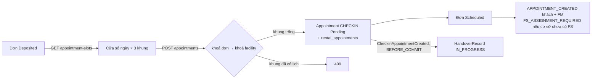

# Đặt lịch check-in (Flow 1.5)

Code: `booking/application/AppointmentBookingService.java`; route
[appointment-slots.md](../routes/booking/appointment-slots.md), [appointment-book.md](../routes/booking/appointment-book.md);
listener mở biên bản `handover/application/CheckinAppointmentCreatedListener.java`.

## Sơ đồ

## Cửa sổ ngày và khung giờ

- 3 khung cố định mỗi ngày, giờ Việt Nam: `08:00–10:00`, `13:00–15:00`, `17:00–19:00` — hằng số trong code, không
  lưu ở `policies` (`appointment.daily_slot_count = 3` chỉ để BOM đọc).
- "Lúc cọc" = mốc **muộn nhất** trong:
  - `paid_at` sớm nhất của giao dịch `Success` thuộc hoá đơn `Deposit` `Paid` mới nhất của đơn (đọc qua
    `PaymentService.firstPaidAt`) — bắt buộc, không xác định được → 409 "Chưa xác định được mốc đặt cọc của đơn…";
  - như trên cho hoá đơn `DepositSupplement` `Paid` (nếu có);
  - `proposal_feedbacks.agreed_at` của lần khách đồng ý đề xuất khoang gần nhất (V23; đề xuất đồng ý trước V23 không
    có mốc nên bỏ qua).

  Đơn đã cọc nhưng phải đổi khoang (khoang bị giữ trước, từ chối tại bàn giao) vì vậy tính cửa sổ lại từ lúc đồng ý
  khoang mới / trả cọc bổ sung, không bị quá hạn vì thời gian chờ cơ sở đề xuất. Đơn thường (đồng ý rồi mới cọc) mốc
  vẫn là lúc trả cọc.
- **Lần đặt đầu tiên:** quá `lúc cọc + appointment.booking_window_days` (7) → 409 "Đã quá hạn đặt lịch check-in";
  `maxDate = min(lúc cọc + appointment.max_days_after_deposit (14), ngày của expires_at)`.
- **Đặt lại** — đơn đã có lịch `CHECKIN` `Canceled` (no-show, FS huỷ lịch, phiên bàn giao quá hạn đưa đơn về
  `Deposited`; `AppointmentRepository.existsCanceledCheckinByOrderId`): **bỏ** kiểm `booking_window_days`;
  `maxDate` = ngày của `expires_at`. Khách đặt lại được chừng nào đơn còn trong hạn giữ.
- `minDate` = hôm nay; `maxDate < minDate` → 409 "Không còn khung giờ trước hạn giữ kho…".
- Khung `available = false` khi: đã qua giờ bắt đầu, kết thúc sau `RentalOrder.expires_at`, hoặc cơ sở đã có lịch
  `CHECKIN` chưa huỷ (`Pending`/`Done`) cùng giờ bắt đầu.

## Đặt lịch

| Điều kiện | Kết quả |
|---|---|
| đơn không thuộc khách | 404 |
| đơn đã có lịch `Pending` | 409 "Đơn thuê đã có lịch hẹn check-in" |
| đơn không `Deposited` | 409 |
| đơn `needs_reproposal`, proposal mới nhất `Pending`, hoặc còn hoá đơn cọc bổ sung `Unpaid` (khách vừa từ chối khoang tại bàn giao) | 409 "Cơ sở đang sắp xếp khoang khác cho đơn này…" |
| ngày ngoài `[minDate, maxDate]` / `startAt` không đúng giờ một khung / khung đã qua | 400 |
| khung kết thúc sau `expires_at` | 409 |
| khung đã có lịch tại cơ sở | 409 "Khung giờ đã có người đặt, vui lòng chọn khung khác" |
| hợp lệ | tạo lịch, đơn `Deposited → Scheduled` |

Ghi nhận khi tạo: `Appointment(CHECKIN, Pending, staff_id = null)` + dòng `rental_appointments`; audit
`APPOINTMENT_CREATED` cho Appointment và RentalOrder (actor = khách); `HANDOVER_RECORD_CREATED` (actor = hệ thống).

## Bất biến

- **Capacity 1 lịch `CHECKIN` / cơ sở / khung:** khoá đơn rồi khoá row `facilities` (`select … for update`) trong
  cùng transaction, kiểm khung trống rồi mới insert — không có unique index.
- **Thứ tự khoá đơn → lịch** giống phân công FS và cascade.
- **HandoverRecord sinh cùng transaction:** booking phát `CheckinAppointmentCreated(appointmentId, orderId, unitId)`;
  handover nghe `BEFORE_COMMIT`, idempotent theo `appointment_id`. Insert lỗi (vd đơn đã có record đang mở —
  partial unique index) rollback cả lịch hẹn.
- **Không đổi lịch:** khách không đổi được lịch check-in `Pending` — không có API đổi lịch và policy
  `appointment.checkin_reschedule_enabled` không được seed. Lịch bị huỷ (no-show, FS huỷ, quá hạn bàn giao) và đơn về
  `Deposited` thì khách đặt lịch mới theo luật "đặt lại" ở trên.
- **`AppointmentBookingService.bookable(orderId)`** chạy cùng kiểm tra cửa sổ như lúc đặt (trạng thái, chờ đề xuất
  lại, mốc cọc, cửa sổ ngày) và trả `true`/`false` thay vì 409. Dùng để quyết định hiện hành động `BOOK_CHECKIN`
  trên đơn ([rental-orders-mine.md](../routes/booking/rental-orders-mine.md)) và trả `bookCheckinOrderId` sau khi trả
  cọc ([invoice-payment-check.md](../routes/booking/invoice-payment-check.md)) — không hiện nút cho thao tác chắc
  chắn bị 409.
- Ba khung cố định dùng chung với lịch `RETURN` (trả kho): một khung đã có lịch check-in **hoặc** trả kho còn hiệu
  lực tại cơ sở thì không đặt được nữa (`AppointmentRepository.findTakenSlotStarts`).
- Lịch check-in bị huỷ khi khách chưa đến (cron no-show, hoặc FS huỷ lịch): booking khoá đơn → khoá lịch, phát
  `CheckinAppointmentClosed` để handover đóng `HandoverRecord` của lịch, rồi trả đơn `Scheduled/InProgress →
  Deposited` (khoang vẫn `Reserved`). Đơn đã quá `expires_at` thì chạy Cascade: no-show dùng lý do "Không đến nhận
  kho quá hạn giữ", FS huỷ dùng lý do FS nhập. Cascade đã gửi `RENTAL_ORDER_CANCELED` nên không gửi thêm
  `APPOINTMENT_CANCELED_NO_SHOW`.
