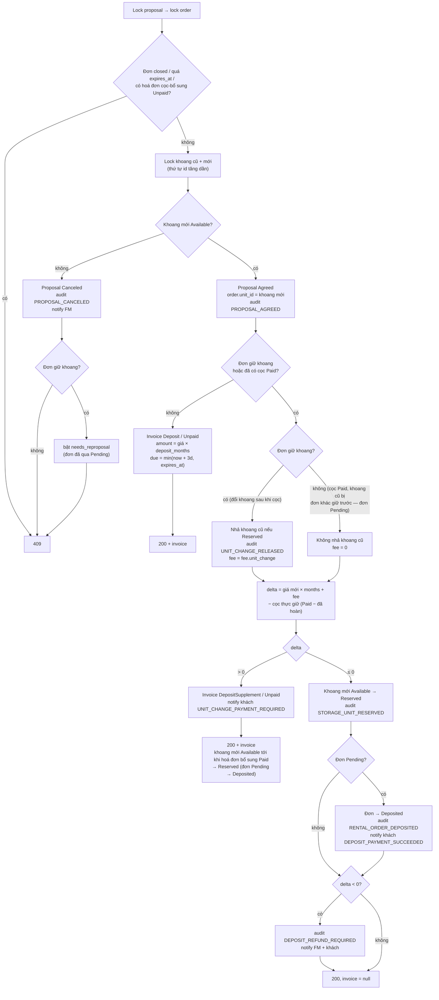
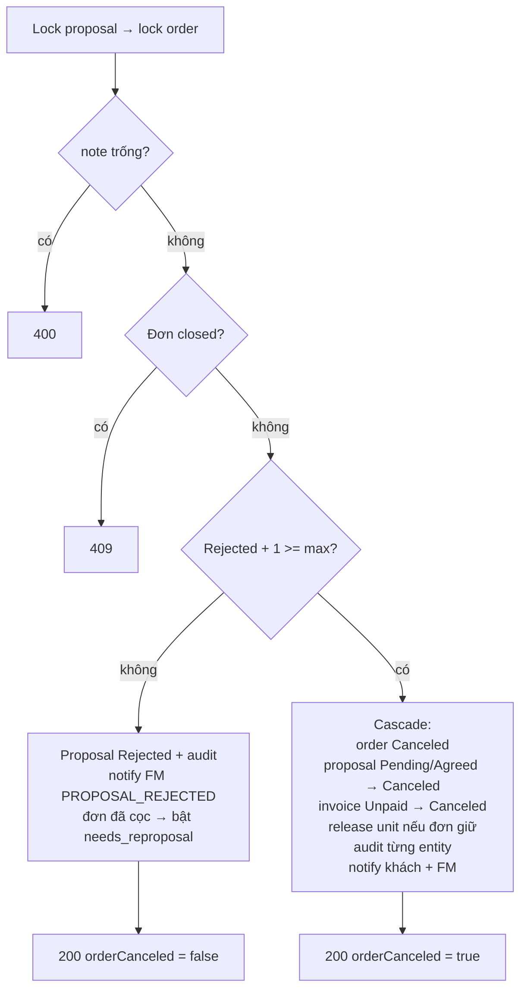
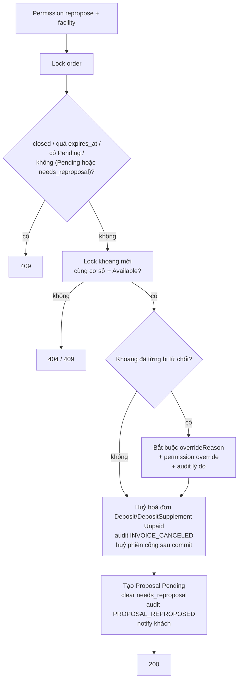

# Đề xuất khoang — đồng ý, từ chối, đề xuất lại

Behavior as-built của Flow 1.3. Contract từng endpoint nằm trong `routes/booking/*`; trang này giữ
overview, state machine và invariant.

## Khách đồng ý — `POST /api/proposals/{id}/agree`

> `Đơn giữ khoang?` là `RentalOrder.holdsUnit()` — đơn `Deposited`/`Scheduled`/`InProgress`. Nhánh khoang không
> Available dùng nó để bật `needs_reproposal`; nhánh thành công dùng nó để quyết định có nhả khoang cũ và có tính
> `fee.unit_change` hay không.
>
> Đơn đã trả cọc nhưng khoang bị đơn khác giữ trước (thanh toán chốt cọc thấy khoang không còn `Available`, đơn ở lại
> `Pending` với `Deposit` `Paid`) đi nhánh "không giữ khoang": khách không gây ra việc đổi khoang nên không thu phí
> đổi khoang, khoang cũ không phải của đơn nên không nhả. Cọc đã đủ → giữ khoang thay thế và chốt đơn `Deposited`
> ngay; còn thiếu → hoá đơn `DepositSupplement`, khi trả xong `InvoicePaymentSettlement` thấy đơn còn `Pending` thì chốt
> cọc như hoá đơn `Deposit` (giữ khoang, đơn `Deposited`, audit `RENTAL_ORDER_DEPOSITED`, khách nhận
> `DEPOSIT_PAYMENT_SUCCEEDED`).

## Khách từ chối — `POST /api/proposals/{id}/reject`

Cascade chi tiết: [flows/cancellation-cascade.md](../flows/cancellation-cascade.md).

## FM đề xuất lại — `POST /api/rental-orders/{id}/proposals`

## State machines

| Entity | Transition |
|---|---|
| `ProposalFeedback` | `Pending → Agreed` · `Pending → Rejected` · `Pending → Canceled` (unit unavailable) · `Agreed → Canceled` (cascade) |
| `RentalOrder` | `Pending → Deposited` (thanh toán cọc; hoặc cọc đã `Paid` mà khoang bị giữ trước — đồng ý khoang thay thế khi cọc đủ / trả xong hoá đơn bổ sung) · `Pending/Deposited/Scheduled/InProgress → Canceled` (cascade) · `Deposited → Scheduled → InProgress → Done` (Flow 1.5/2) |
| `StorageUnit` | `Available ↔ Reserved` (thanh toán cọc / release) · `Available ↔ Maintenance` (Flow 2.5) |
| `Invoice` | `Unpaid → Paid` (thanh toán cọc) · `Unpaid → Canceled` (cascade / re-propose) · `Unpaid → Expired` (cron) |

## Invariants

- Một `Deposit` active (`Unpaid`/`Paid`) + một `DepositSupplement` `Unpaid` trên mỗi đơn — partial unique index của V11.
- Cọc = giá hiệu lực × `invoice.deposit_months`; hạn = `min(now + deposit_due_days, expires_at)`.
- Delta = cọc khoang mới + `fee.unit_change` (chỉ khi đơn giữ khoang) − cọc thực đang giữ (tổng `Paid` của `Deposit` + `DepositSupplement` trừ các khoản hoàn thủ công đã ghi nhận trên các
  hoá đơn đó — đổi sang khoang rẻ hơn rồi đổi tiếp thì không tính lại phần đã hoàn).
- Chỉ nhả khoang khi đơn thực sự giữ khoang (`Deposited`/`Scheduled`/`InProgress`) — cả khi huỷ đơn lẫn khi đổi
  khoang (`releaseReplacedUnit`).
- FM đề xuất lại huỷ hoá đơn `Deposit`/`DepositSupplement` `Unpaid` của đơn và **huỷ phiên payOS/VNPay của các hoá đơn
  đó sau commit** (`PaymentSessionCloser.closeAfterCommit`, lý do "FM đề xuất lại khoang khác") — khách không còn trả
  được vào link của hoá đơn đã huỷ.
- Khoang mới: còn thiếu cọc → giữ khoang khi hoá đơn bổ sung `Paid`; cọc đã đủ (`delta ≤ 0`, không có hoá đơn
  bổ sung) → `Available → Reserved` ngay trong bước đồng ý, audit `STORAGE_UNIT_RESERVED` (lý do "Đổi khoang sau
  khi đã cọc"). Đơn đã cọc luôn giữ khoang của mình — đặt lịch check-in và bàn giao đều cần khoang `Reserved`.
- Audit một bản ghi mỗi entity thay đổi.

## Ranh giới

- **Flow 2** bật `needs_reproposal`, trả đơn về `Deposited` và gửi FM `HANDOVER_REJECTED` khi khách từ chối khoang tại
  check-in chưa chạm ngưỡng (`HandoverOrderService.rejectUnit`); khoang cũ vẫn `Reserved` tới khi khách đồng ý
  khoang mới.
- **FM không đề xuất lại khi còn proposal `Pending`** (quyết định của chủ dự án): mọi lần gọi khi khách chưa phản hồi
  trả 409; FM liên hệ khách hoặc huỷ đơn.
- **Thanh toán cọc** phải phân biệt `Deposit` và `DepositSupplement`; không mark `Deposited` lần hai cho hoá đơn bổ sung.
- Hoàn tiền do FM chuyển khoản thủ công ngoài hệ thống rồi ghi nhận qua `POST /api/fm/invoices/{invoiceId}/refunds`
  ([payment.md › Hoàn tiền thủ công](../payment.md#hoàn-tiền-thủ-công)); luồng này chỉ notify + audit.
- **FE** nối endpoint + cảnh báo trước lần từ chối cuối bằng `rejectionCount`/`maxRejectionCount`.
