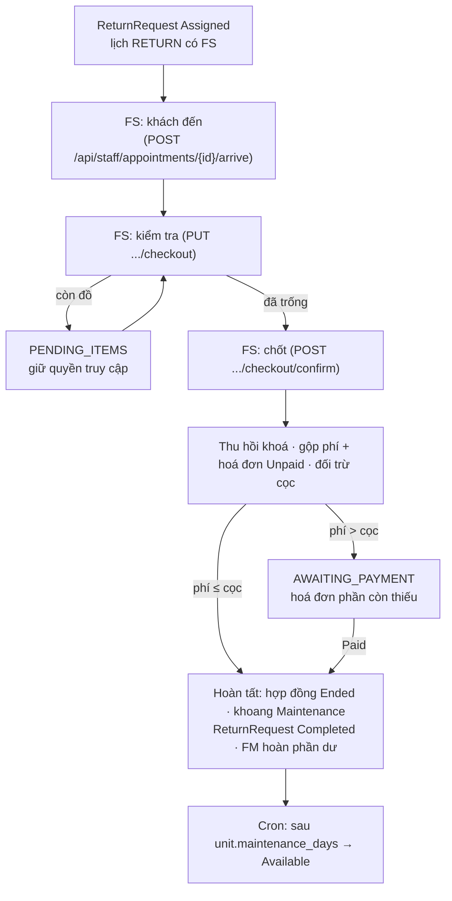

# Trả kho (bản rút gọn của Flow 2.a)

Spec Flow 2.a ghi "chưa qua review, không được phép implement". Nhánh full-demo làm bản rút gọn để vòng đời thuê
kho khép kín; khác biệt so với bản nháp được ghi ở cuối trang.

Code:
- `checkout/application/CheckoutService.java` — kiểm tra, chốt, hoàn tất;
- `checkout/application/CheckoutJobs.java` — listener hoá đơn còn thiếu, cron mở lại khoang;
- `checkout/domain/CheckoutRecord.java`.

## Sơ đồ

## Kiểm tra

`PUT /api/staff/return-requests/{id}/checkout`:
- **Điều kiện:**
  - FS được phân (`assigned_staff_id`) có `unit_access_key.issue` theo cơ sở;
  - yêu cầu ở `Assigned`, lịch `RETURN` đã có `arrived_at`;
  - hợp đồng `Active`.
- **Body:** `unitEmptied`, `cleaningRequired`, `damageAmount` (≥ 0, FS nhập), `damages`, `returnedKeys`,
  `photos` (≤ 20), `note`.
- **Biên bản:** tạo mới ở lần đầu, các lần sau cập nhật trên cùng bản ghi. `unitEmptied=false` → `PENDING_ITEMS`:
  chưa chốt được, quyền truy cập vẫn `Active`. Kiểm lại khi đã trống thì về `IN_PROGRESS`.
- **Audit** `CHECKOUT_INSPECTED`.
- `GET` cùng đường dẫn trả biên bản kèm phí dự kiến: `cleaningFee`, `lostKeyFee`, số chìa đã giao, tổng hoá đơn
  `Unpaid` của hợp đồng, tiền cọc.

## Chốt và quyết toán

`POST /api/staff/return-requests/{id}/checkout/confirm`, một transaction, khoá đơn → hợp đồng → biên bản → hoá đơn:

1. **Thu hồi quyền truy cập** (`RentalContractService.revokeAll`):
   - mã số → `Revoked`;
   - khóa cơ thu đủ chìa → `Revoked`, thiếu chìa → `Lost`;
   - audit `ACCESS_KEY_REVOKED` mỗi dòng.
2. **Tổng phí** = `fee.cleaning` (nếu cần vệ sinh) + hư hỏng + `fee.lost_key × số chìa thiếu` + mọi hoá đơn `Unpaid`
   của hợp đồng (gia hạn chưa trả, phí quá hạn…).
   - Các hoá đơn `Unpaid` đó bị `Canceled` với lý do "Gộp vào quyết toán trả kho".
   - Còn phiên thanh toán mở → 409, thử lại sau.
3. **Đối trừ cọc:**
   - `min(tổng phí, cọc)` thành một hoá đơn `Penalty` "Quyết toán trả kho (đối trừ cọc)", chuyển `Paid` ngay (audit
     `INVOICE_PAID`, `settledBy = deposit`).
   - **Phí ≤ cọc:** `refund_amount = cọc − phí`, hoàn tất ngay.
   - **Phí > cọc:** hoá đơn `Penalty` phần còn thiếu, hạn `checkout.invoice_due_days` (7); biên bản chuyển
     `AWAITING_PAYMENT`; khách nhận `CHECKOUT_PAYMENT_REQUIRED`. Khi hoá đơn này `Paid` (`ContractInvoicePaid`,
     `type = Penalty`) thì hoàn tất.

## Hoàn tất

- hợp đồng `Active → Ended` (audit `CONTRACT_ENDED`);
- khoang `Rented → Maintenance` + `maintenance_started_at` (audit `STORAGE_UNIT_MAINTENANCE`);
- `ReturnRequest → Completed`;
- biên bản `COMPLETED` (audit `CHECKOUT_COMPLETED`);
- khách nhận `CHECKOUT_COMPLETED`; còn tiền hoàn thì FM nhận `CHECKOUT_REFUND_REQUIRED` để hoàn thủ công;
- `RentalOrder` giữ `Done`.

## Bảo trì → mở lại

`CheckoutJobs.reopenUnits` chạy mỗi 10 phút (`checkout.maintenance.fixed-delay-ms`), mỗi khoang một transaction:
- áp dụng khoang có `maintenance_started_at` và `maintenance_started_at + unit.maintenance_days` (2 ngày) đã qua;
- `Maintenance → Available`, xoá `maintenance_started_at`, audit `STORAGE_UNIT_AVAILABLE`;
- bảo trì FM bật tay (không có `maintenance_started_at`) không bị đụng.

## Khác bản nháp 2.a

- **Khoang còn đồ:** không tự tạo lịch `RETURN` mới — FS kiểm lại trên cùng biên bản khi khách quay lại.
- **Không có chữ ký khách:** dùng biên bản xem trên web, không có `customer_signature`.
- **Phí:** đọc từ policy `fee.cleaning` / `fee.lost_key`, chưa có bảng `ExtraFee`. Phí hư hỏng do FS nhập số tiền.
- **Đối trừ cọc:** ghi thành hoá đơn `Penalty` `Paid`, không có trạng thái riêng cho tiền cọc.
- **Không tách cờ từng mốc:** không có cờ riêng cho thu phí / xử lý cọc; trạng thái suy ra từ `result`,
  `access_revoked_at`, `shortfall_invoice_id`.

## Policy (V20)

| Key | Mặc định |
|---|---:|
| `fee.cleaning` | 100000 |
| `fee.lost_key` | 200000 |
| `unit.maintenance_days` | 2 |
| `checkout.invoice_due_days` | 7 |
