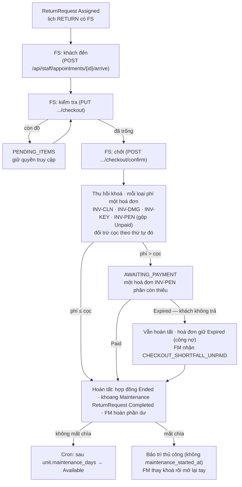

# Trả kho (bản rút gọn của Flow 2.a)

Spec Flow 2.a ghi "chưa qua review, không được phép implement". Theo quyết định của chủ dự án, trả kho được làm ở
dạng rút gọn để vòng đời thuê kho khép kín; khác biệt so với bản nháp được ghi ở mục
[Khác bản nháp 2.a](#khác-bản-nháp-2a). Trang này cũng là contract của các route trả kho (không có file riêng trong
`routes/`); field chi tiết nằm ở Swagger trên `checkout/controller/CheckoutController.java`.

Code:
- `checkout/application/CheckoutService.java` — kiểm tra, chốt, hoàn tất;
- `checkout/application/CheckoutJobs.java` — listener hoá đơn phần còn thiếu (`Paid` / `Expired`), cron mở lại khoang;
- `booking/application/ContractInvoiceService.java` — lập / đối trừ / gộp hoá đơn quyết toán;
- `checkout/domain/CheckoutRecord.java`.

## Route

Bearer token + `ACCOUNT_ACTIVE`; `/api/staff/**` cần role `FS`, `/api/customer/**` cần role `CUSTOMER` (sai role →
403). Lỗi nghiệp vụ trả `{message, timestamp}` qua `TenancyExceptionHandler`.

| Method | Path | Ai gọi | Lỗi chính |
|---|---|---|---|
| GET | `/api/staff/return-requests/{id}/checkout` | FS có `unit_access_key.issue` tại cơ sở của yêu cầu | 403 thiếu quyền / ngoài cơ sở; 404 "Không tìm thấy yêu cầu trả kho" |
| PUT | `/api/staff/return-requests/{id}/checkout` | FS được phân (`assigned_staff_id`) có `unit_access_key.issue` | 400 thiếu `unitEmptied`, `damageAmount` âm, `returnedKeys` âm, > 20 ảnh, `damages`/`note` > 2000 ký tự; 403 không phải FS phụ trách; 404; 409 yêu cầu không `Assigned`, chưa xác nhận khách đến, hợp đồng không `Active` |
| POST | `/api/staff/return-requests/{id}/checkout/confirm` | FS được phân có `unit_access_key.issue` | như `PUT`, thêm 409 "Chưa có kết quả kiểm tra khoang", "Khoang còn tài sản — chưa chốt trả kho được", "Biên bản trả kho đã chốt", hoá đơn cần gộp còn phiên thanh toán mở |
| GET | `/api/customer/return-requests/{id}/checkout` | khách chủ hợp đồng của yêu cầu | 404 (không có / của khách khác) |

## Sơ đồ

## Kiểm tra

`PUT /api/staff/return-requests/{id}/checkout`:
- **Điều kiện:**
  - FS được phân (`assigned_staff_id`) có `unit_access_key.issue` theo cơ sở;
  - yêu cầu ở `Assigned`, lịch `RETURN` đã có `arrived_at`;
  - hợp đồng `Active`.
- **Body:** `unitEmptied`, `cleaningRequired`, `damageAmount` (số nguyên VND ≥ 0, FS nhập; có phần lẻ → 400), `damages`, `returnedKeys`,
  `photos` (≤ 20), `note`. Ảnh là upload `Pending` của FS thì được attach phía server (`media.MediaAttachments`) để
  cron dọn upload bỏ ngang không xoá; URL không khớp upload của FS vẫn lưu, chỉ không attach.
- **Biên bản:** tạo mới ở lần đầu, các lần sau cập nhật trên cùng bản ghi. `unitEmptied=false` → `PENDING_ITEMS`:
  chưa chốt được, quyền truy cập vẫn `Active`. Kiểm lại khi đã trống thì về `IN_PROGRESS`.
- **Audit** `CHECKOUT_INSPECTED`.
- `GET` cùng đường dẫn trả biên bản kèm phí dự kiến: `cleaningFee`, `lostKeyFee`, số chìa đã giao, tổng hoá đơn
  `Unpaid` của hợp đồng, tiền cọc.

## Chốt và quyết toán

`POST /api/staff/return-requests/{id}/checkout/confirm`, một transaction, khoá đơn → hợp đồng → biên bản → hoá đơn:

1. **Thu hồi quyền truy cập** (`RentalContractService.revokeAll`):
   - mã số → `Revoked`;
   - khóa cơ thu đủ chìa → `Revoked`, thiếu chìa → `Lost`;
   - audit `ACCESS_KEY_REVOKED` mỗi dòng.
2. **Các khoản phí** — mỗi loại phí là một hoá đơn `Penalty` riêng, tiền tố mã theo loại:

   | Tiền tố | Khoản | Số tiền |
   |---|---|---|
   | `INV-CLN` | Phí vệ sinh | `fee.cleaning` nếu FS đánh dấu cần vệ sinh |
   | `INV-DMG` | Phí hư hỏng | `damageAmount` FS nhập |
   | `INV-KEY` | Phí mất chìa | `fee.lost_key × số chìa thiếu` |
   | `INV-PEN` | Hoá đơn chưa thanh toán gộp vào quyết toán | tổng mọi hoá đơn `Unpaid` của hợp đồng (tiền thuê tháng, gia hạn, phí quá hạn, phí dịch vụ…) + tiền thuê tháng đã `Expired` (nợ thuê chưa trả) |

   - Các hoá đơn `Unpaid` và tiền thuê `Expired` được gộp bị `Canceled` lý do "Gộp vào quyết toán trả kho" (audit
     `INVOICE_CANCELED`). `GET` biên bản (`unpaid`) cũng tính cả tiền thuê `Expired`. Phiên
     cổng của chúng huỷ sau commit. Còn phiên thanh toán mở → 409, thử lại sau.
   - Khoản bằng 0 không sinh hoá đơn.
3. **Đối trừ cọc** theo thứ tự `CLN → DMG → KEY → PEN`: phần mỗi khoản được cọc còn lại phủ thành hoá đơn của loại
   đó, `Paid` ngay (`ContractInvoiceService.settleByDeposit`; audit `INVOICE_CREATED` + `INVOICE_PAID` lý do "Đối trừ
   tiền cọc", `settledBy = deposit`). Hoá đơn đối trừ không qua cổng thanh toán.
   - **Phí ≤ cọc:** `refund_amount = cọc − phí`, hoàn tất ngay.
   - **Phí > cọc:** phần còn lại của mọi khoản gom thành **một** hoá đơn `INV-PEN` `Unpaid` "Quyết toán trả kho — phần
     còn thiếu", hạn `checkout.invoice_due_days` (7); biên bản chuyển `AWAITING_PAYMENT`
     (`shortfall_invoice_id`); khách nhận `CHECKOUT_PAYMENT_REQUIRED`.
     - Hoá đơn này `Paid` (`ContractInvoicePaid`, `type = Penalty`) → hoàn tất.
     - Hoá đơn này `Expired` (cron booking phát `ContractInvoiceExpired`, `CheckoutService.onShortfallExpired`) → trả kho
       **vẫn hoàn tất** (khách đã dọn đồ và trả chìa, khoang không bị kẹt) theo các bước hoàn tất bên dưới (một
       audit `CHECKOUT_COMPLETED`). Hoá đơn giữ `Expired` làm chứng từ
       công nợ; FM nhận `CHECKOUT_SHORTFALL_UNPAID` (mã khoang, mã hợp đồng, số tiền thiếu) để thu thủ công.

Đã có hoá đơn quyết toán (`INV-CLN`/`DMG`/`KEY`/`PEN` chưa `Canceled`) thì cron phí quá hạn không phát hành lại
`INV-OVD` cho hợp đồng (`ContractInvoiceService.syncOverdueFee`) — phí quá hạn chưa trả đã gộp vào `INV-PEN`.

## Hoàn tất

- hợp đồng `Active → Ended` (audit `CONTRACT_ENDED`);
- khoang `Rented → Maintenance` (audit `STORAGE_UNIT_MAINTENANCE`):
  - bình thường: ghi `maintenance_started_at`, `new_value.reason` "Bảo trì sau trả kho" — cron mở lại sau
    `unit.maintenance_days`;
  - bộ chìa mới nhất của hợp đồng ở `Lost` (thiếu chìa lúc chốt): **không** ghi `maintenance_started_at`, `new_value.reason`
    "Bảo trì sau trả kho — thay khoá do mất chìa" — bảo trì thủ công, cron không tự mở lại; FM thay khoá rồi mở lại
    bằng `POST /api/fm/storage-units/{id}/maintenance`;
- `ReturnRequest → Completed`;
- biên bản `COMPLETED` (audit `CHECKOUT_COMPLETED`);
- khách nhận `CHECKOUT_COMPLETED`; còn tiền hoàn thì hoá đơn cọc của đơn vào hàng đợi hoàn tiền
  (`refund_status = Required`, `refund_amount` = số hoàn, lý do `CHECKOUT_DEPOSIT`, audit `INVOICE_REFUND_REQUIRED`) và FM
  nhận `CHECKOUT_REFUND_REQUIRED`, chuyển khoản hoàn rồi ghi nhận qua `POST /api/fm/invoices/{invoiceId}/refunds`
  ([payment.md](../payment.md#hoàn-tiền-thủ-công));
- `RentalOrder` giữ `Done`.

## Bảo trì → mở lại

`CheckoutJobs.reopenUnits` chạy mỗi 10 phút (`checkout.maintenance.fixed-delay-ms`), mỗi khoang một transaction:
- áp dụng khoang có `maintenance_started_at` và `maintenance_started_at + unit.maintenance_days` (2 ngày) đã qua;
- `Maintenance → Available`, xoá `maintenance_started_at`, audit `STORAGE_UNIT_AVAILABLE`;
- bảo trì không có `maintenance_started_at` không bị đụng: FM bật tay, trả kho có mất chìa, hoặc FM bấm "Giữ bảo
  trì" (`POST /api/fm/storage-units/{unitId}/maintenance-hold` — xoá mốc của khoang đang chờ cron mở lại, xem
  [backoffice/overview.md](../backoffice/overview.md)). Các khoang này FM mở lại tay.

## Khác bản nháp 2.a

- **Khoang còn đồ:** không tự tạo lịch `RETURN` mới — FS kiểm lại trên cùng biên bản khi khách quay lại.
- **Không có chữ ký khách:** dùng biên bản xem trên web, không có `customer_signature`.
- **Phí:** đọc từ policy `fee.cleaning` / `fee.lost_key`, chưa có bảng `ExtraFee`. Phí hư hỏng do FS nhập số tiền.
- **Đối trừ cọc:** ghi thành hoá đơn `Penalty` `Paid` theo từng loại phí, không có trạng thái riêng cho tiền cọc.
- **Khách không trả phần thiếu:** trả kho vẫn đóng khi hoá đơn phần thiếu quá hạn; nợ ở lại trên hoá đơn `Expired`.
- **Không tách cờ từng mốc:** không có cờ riêng cho thu phí / xử lý cọc; trạng thái suy ra từ `result`,
  `access_revoked_at`, `shortfall_invoice_id`.

## Policy (V25)

| Key | Mặc định |
|---|---:|
| `fee.cleaning` | 100000 |
| `fee.lost_key` | 200000 |
| `unit.maintenance_days` | 2 |
| `checkout.invoice_due_days` | 7 |
