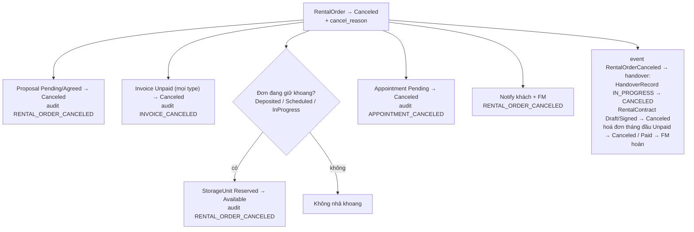

# Cancellation Cascade

Chạy khi `RentalOrder` chuyển `Canceled`. Cascade chạy trong transaction của caller, đơn đã được caller khoá.

Entry point hiện có:

| Nguồn | Lý do (`cancel_reason`) |
|---|---|
| Khách từ chối proposal lần thứ `proposal.max_rejection_count` | "Từ chối quá số khoang cho phép" |
| Khách huỷ (`POST /api/rental-orders/{id}/cancel`) | "Khách hủy đơn" |
| FM huỷ (`POST /api/fm/rental-orders/{id}/cancel`) | lý do FM nhập, mặc định "Khách không còn nhu cầu" |
| Cron hoá đơn cọc quá hạn | "Quá hạn thanh toán cọc" |
| Cron catch-all đơn quá `expires_at` | theo trạng thái — xem [deposit-payment.md › Cron Flow 1](../booking/deposit-payment.md#cron-flow-1) |
| Cron no-show khi đơn đã quá hạn giữ | "Không đến nhận kho quá hạn giữ" |
| FS huỷ lịch check-in khi đơn đã quá hạn giữ | lý do FS nhập |
| Khách từ chối khoang tại bàn giao lần thứ `handover.max_rejection_count` (đã xác nhận) | "Từ chối quá số khoang cho phép" |
| FS ghi nhận khách không ký hợp đồng `Draft` | "Khách không ký hợp đồng" |
| Cron phiên bàn giao quá `due_at` khi đơn đã quá hạn giữ | "Chưa hoàn tất bàn giao trong hạn" |
| Cron hoá đơn tháng đầu quá hạn khi đơn đã quá hạn giữ | "Quá hạn thanh toán tháng đầu" |

## Sơ đồ

## Các bước

1. `RentalOrder.status → Canceled`, ghi `cancel_reason`; đơn đã đóng thì ném lỗi — caller phải guard.
2. Mọi `ProposalFeedback` `Pending`/`Agreed` của đơn → `Canceled`, audit từng proposal.
3. Mọi `Invoice` `Unpaid` của đơn → `Canceled`, audit từng invoice; phiên thanh toán còn mở của các hoá đơn đó bị
   huỷ ở cổng **sau commit** (`PaymentSessionCloser.closeAfterCommit`, best-effort — lỗi cổng không rollback việc
   huỷ; giao dịch giữ `Pending` cho webhook / đối soát quyết).
4. Mọi `Appointment` `Pending` của đơn → `Canceled`, ghi `cancel_reason`; audit `APPOINTMENT_CANCELED` với
   actor = System.
5. Khoang: chỉ nhả `Reserved → Available` khi đơn bị huỷ **thực sự đang giữ khoang**
   (`Deposited`/`Scheduled`/`InProgress`) **và** là đơn ghi ở `storage_units.reserved_order_id` (V25). Đơn `Pending`
   mới gán `unit_id` chưa cọc nên không nhả; đơn đã cọc đổi khoang mà khoang mới bị đơn khác cọc trước vẫn trỏ
   `unit_id` tới khoang đó nhưng không giữ — không nhả khoang của đơn kia. Khoang `Reserved` từ trước V25 không xác
   định được đơn giữ (`reserved_order_id` NULL) nhả theo luật cũ.
6. Khách + FM nhận notification `RENTAL_ORDER_CANCELED`; lý do khách chịu rủi ro (quá ngưỡng từ chối)
   thì body nêu rõ "Tiền cọc không được hoàn". Tiêu đề / body ghi "đã hết hạn" khi huỷ vì quá hạn — lý do thuộc
   `BookingExpiryService.EXPIRY_REASONS` (quá hạn cọc, quá hạn xác nhận đề xuất, quá hạn đặt lịch check-in, không đến
   nhận kho quá hạn giữ, chưa hoàn tất bàn giao trong hạn), hoặc hệ thống (không có actor) đóng đơn đã qua
   `expires_at`; còn lại ghi "đã bị hủy".
7. Phát `RentalOrderCanceled(orderId, unitId, reason)` đồng bộ: module handover đóng biên bản đang mở và huỷ hợp
   đồng `Draft`/`Signed` của đơn (`HandoverService.cancelByOrderId`, audit `HANDOVER_CANCELED` /
   `CONTRACT_CANCELED`). Hợp đồng `Signed` bị huỷ thì hoá đơn của hợp đồng (tháng đầu, chỉ gắn `contract_id` nên
   bước 3 không thấy) được đóng qua `HandoverOrderService.closeContractInvoices`: `Unpaid → Canceled` (huỷ phiên
   cổng sau commit), `Paid` → FM nhận `FIRST_MONTH_REFUND_REQUIRED` để hoàn thủ công. Lỗi ở listener rollback cả
   việc huỷ đơn.
8. Audit một bản ghi mỗi entity thay đổi.

## Ranh giới

- `booking` không gọi `handover` trực tiếp (ModuleStructureTest chặn) — phần biên bản/hợp đồng đi qua event
  `RentalOrderCanceled` (bước 7).
- Cascade không hoàn cọc; hoàn tiền (nếu có) do FM chuyển khoản thủ công ngoài hệ thống rồi ghi nhận qua
  `POST /api/fm/invoices/{invoiceId}/refunds` ([payment.md › Hoàn tiền thủ công](../payment.md#hoàn-tiền-thủ-công)) —
  cascade chỉ dừng ở notification + audit.
- Cron chờ phiên thanh toán đang mở (giao dịch `Pending` chưa được cổng xác nhận đóng, tạo trong 24 giờ gần nhất —
  [payment.md › Khoá phiên](../payment.md#khoá-phiên--huỷ-phiên)) đóng xong mới huỷ đơn / hết hạn hoá đơn.
