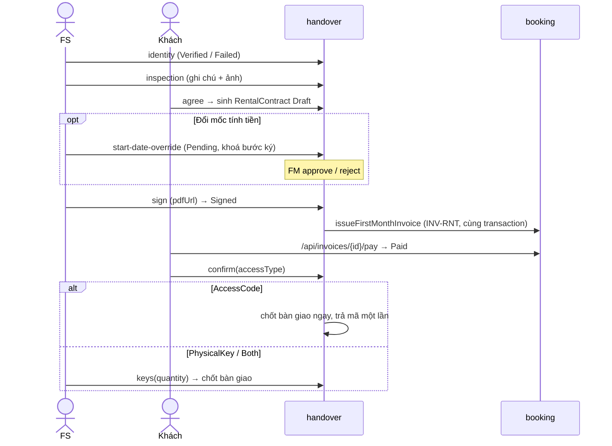

# Bàn giao — HandoverRecord, RentalContract, UnitAccessKey

Code: `handover/application/HandoverWorkflowService.java` (thao tác FS/khách/FM), `HandoverCompletion.java` (chốt
bàn giao), `HandoverService.java` (huỷ phiên), `HandoverExpiryService.java` (cron), `HandoverQueryService.java`
(view), `ContractDocumentService.java` (bản hợp đồng). Booking cung cấp `booking/application/HandoverOrderService.java`
— handover chỉ đổi `RentalOrder`/`Invoice` qua API này.

## Sơ đồ

## HandoverRecord

Bảng `handover_records` (V1, V19). Entity `handover/domain/HandoverRecord.java`.

- `appointment_id` **unique**; mỗi đơn tối đa một record `IN_PROGRESS` (partial unique index
  `uq_handover_records_open_per_order`).
- `result`: `IN_PROGRESS | COMPLETED | REJECTED | CANCELED`.
- `identity_status`: `Pending → Verified` (chốt) hoặc `Pending/Failed → Failed`; `Failed` vẫn xác minh lại được trong
  hạn `due_at` (khách quay lại với giấy tờ đúng).
- `inspection_status`: `Pending → Agreed` (khách đồng ý) hoặc `Rejected` (khách từ chối khoang).
- `requested_access` (V19): `AccessCode | PhysicalKey | Both` — lựa chọn của khách khi xác nhận biên bản;
  `customer_confirmed_at` (V19).
- Bảng không có `arrived_at`; mốc khách đến đọc qua `appointments.arrived_at`.

## RentalContract

Bảng `rental_contracts` (V1). Entity `handover/domain/RentalContract.java`.

- `status`: `Draft → Signed → Active`; `Draft`/`Signed` → `Canceled` khi phiên bàn giao đóng.
- `end_date = start_date + period tháng − 1 ngày`, tính lại khi FM duyệt mốc mới.
- `start_date_override_status`: `Pending → Approved | Rejected`; `Pending` khoá bước ký và bản in.

## UnitAccessKey

Bảng `unit_access_keys` (V1). Entity `handover/domain/UnitAccessKey.java`.

- `PhysicalKey`: ghi `quantity` (1–10). `AccessCode`: mã 6 số, chỉ lưu `code_hash` (BCrypt, cùng `PasswordEncoder`
  với mật khẩu); mã rõ chỉ trả trong response lúc cấp.
- "Lấy mã" (`POST /api/customer/contracts/{id}/access-code`): thu hồi dòng `AccessCode` `Active` (`Revoked`, audit
  `ACCESS_KEY_REVOKED`) rồi cấp mã mới. Spec vừa yêu cầu "không lưu plain text" vừa "khách xem mã trong tài khoản" —
  hai điều không cùng đúng với hash, nên "xem" được làm thành "cấp mã mới". Chỉ hợp đồng `Active`, cơ sở bật mã số.

## Cấu hình cơ sở

`facilities.enabled_key_access`, `enabled_code_access` (V19, mặc định `true`) — chưa có màn hình Flow 5 để đổi.
Khách chỉ chọn được loại cơ sở đang bật; `Both` cần bật cả hai.

## Tạo record khi đặt lịch (Flow 1.5)

- `CheckinAppointmentCreatedListener` nghe `CheckinAppointmentCreated(appointmentId, orderId, unitId)`,
  `BEFORE_COMMIT` trong transaction đặt lịch.
- `HandoverRecord.open(...)`: `IN_PROGRESS`, hai cờ `Pending`, `due_at` null. Audit `HANDOVER_RECORD_CREATED`.
- Idempotent theo `appointment_id`; đơn đã có record mở → partial unique index chặn, rollback cả lịch hẹn.

## Flow 2.1 — khách đến và `due_at`

1. FS bấm "khách đến" (`StaffAppointmentActionService.arrive`): khoá đơn → khoá lịch, `Pending → Done`, ghi
   `arrived_at`, audit `APPOINTMENT_ARRIVED`, phát `AppointmentArrived`.
2. `AppointmentArrivedListener` (`BEFORE_COMMIT`): record mở, chưa có `due_at` → set
   `due_at = min(arrived_at + handover.due_days, RentalOrder.expires_at)`; set một lần.
3. `handover.due_days` (V16 = 1) `< 1` → `IllegalStateException`.

## Flow 2.2–2.4 — thao tác

Mọi thao tác ghi khoá theo thứ tự **đơn → biên bản → hợp đồng → khoang**, cùng chiều Cancellation Cascade. Điều
kiện chung: record `IN_PROGRESS`, đơn `InProgress`, khách đã đến (`arrived_at` có giá trị) → sai thì 409.

| Bước | Ai | Điều kiện thêm | Kết quả | Audit |
|---|---|---|---|---|
| Xác minh danh tính | FS phụ trách (`appointments.staff_id`), `handover_record.verify_identity` | chưa `Verified` | `Verified` + `identity_verified_at`, hoặc `Failed` (phiên vẫn mở) | `IDENTITY_VERIFIED` (old/new `identityStatus`, `note`) |
| Ghi hiện trạng | FS, `handover_record.inspect` | `Verified`, hiện trạng còn `Pending` | `inspection_notes`, `inspection_photos` (≤ 20 URL từ `/api/media`) | — |
| Đồng ý hiện trạng | Khách của đơn | `Verified`, hiện trạng `Pending` | `Agreed` + `unit_inspected_at`; ghi chú khách nối vào notes ("Khách lưu ý: …"); sinh hợp đồng `Draft` nếu đơn chưa có | `UNIT_INSPECTED` |
| Đề nghị đổi mốc | FS, `rental_contract.start_date_override.request` | hợp đồng `Draft`, chưa có đề nghị `Pending`, ngày ≥ hôm nay | `start_date_override_* = Pending` | `START_DATE_OVERRIDE_REQUESTED` |
| Duyệt / từ chối mốc | FM, `rental_contract.start_date_override.review` + facility scope | có đề nghị `Pending` | duyệt: `start_date` = ngày đề nghị; từ chối: giữ ngày chính sách | `START_DATE_OVERRIDE_APPROVED` / `_REJECTED` |
| Ký hợp đồng | FS, `rental_contract.sign` | `Verified` + `Agreed`, hợp đồng `Draft`, không còn đề nghị `Pending` | `Signed`, `signed_at`, `pdf_url`; tạo hoá đơn tháng đầu | `CONTRACT_SIGNED`, `INVOICE_CREATED` |
| Xác nhận biên bản | Khách | hợp đồng `Signed`, hoá đơn tháng đầu `Paid`, chưa xác nhận, loại truy cập cơ sở đang bật | ghi `requested_access`; `AccessCode` → chốt ngay; `PhysicalKey`/`Both` → FS nhận `HANDOVER_KEY_REQUESTED` | — |
| Giao chìa | FS, `unit_access_key.issue` | khách đã chọn `PhysicalKey`/`Both` | chốt bàn giao | — |

Sinh hợp đồng `Draft`:
- `code = HD-{facility}-{YYMMDD}-{6 ký tự}`;
- `terms_version = builtin-v1` (mẫu dựng sẵn — chưa có bảng mẫu Flow 4);
- `monthly_price = PricingQuery.effectiveMonthlyPrice(unit)`;
- `deposit_amount` = tổng `Deposit` + `DepositSupplement` đã `Paid`;
- `period = rental_requests.period`;
- `start_date` theo `contract.start_date_rule` (V19 = `handover_date` = ngày sinh hợp đồng theo giờ VN; giá trị khác
  log WARN rồi vẫn dùng ngày sinh hợp đồng);
- `document_url = /api/contracts/{id}/document`.

Không có audit riêng cho việc tạo hợp đồng (catalog không có `CONTRACT_CREATED`).

Hoá đơn tháng đầu (`HandoverOrderService.issueFirstMonthInvoice`):
- `type = Rental`, `code = INV-RNT-{facility}-{YYMMDD}-{rand}`;
- chỉ gắn `contract_id`, vì CHECK V1 `num_nonnulls(order_id, contract_id) = 1`;
- `amount = monthly_price × contract.prepaid_months`;
- `due_date = min(now + handover.payment_grace_hours, RentalOrder.expires_at)`;
- cọc không trừ vào hoá đơn này.
- Thanh toán đi qua `/api/invoices/{id}/pay` như mọi hoá đơn. Booking tìm đơn qua `rental_contracts.order_id` để khoá
  đơn trước hoá đơn.

### Chốt bàn giao (`HandoverCompletion`)

Một transaction, chỉ khi record `IN_PROGRESS` (chạy lại → 409):
1. hợp đồng `Signed` + hoá đơn tháng đầu `Paid` + khách đã chọn hình thức;
2. tạo `UnitAccessKey` theo lựa chọn — `PhysicalKey` (số chìa FS nhập), `AccessCode` (mã mới); audit
   `ACCESS_KEY_ISSUED` mỗi dòng;
3. khoang `Reserved → Rented` (không còn `Reserved` → 409, rollback) — audit `STORAGE_UNIT_RENTED`;
4. hợp đồng `Signed → Active` — `CONTRACT_ACTIVATED`;
5. biên bản `COMPLETED` + `completed_at` — `HANDOVER_COMPLETED`;
6. đơn `InProgress → Done` (`HandoverOrderService.complete`) — `RENTAL_ORDER_DONE`.

Sau commit (`HandoverCompleted`, transaction riêng): khách nhận `HANDOVER_COMPLETED` (in-app + email) với link
`{frontend}/handovers/{id}`; lỗi gửi chỉ log ERROR, không rollback.

## Flow 2.5 — từ chối / huỷ

| Khách dừng ở | Từ chối khoang | Huỷ đơn |
|---|---|---|
| Trước ký (hợp đồng chưa có hoặc `Draft`) | xem dưới | API huỷ đơn của booking, lý do "Khách hủy đơn" |
| Sau ký, trước trả tiền | 409 "chỉ còn lựa chọn huỷ đơn" | Cascade; hoá đơn tháng đầu `Unpaid → Canceled` |
| Sau trả tiền, trước nhận khoang | 409 | Cascade; FM nhận `FIRST_MONTH_REFUND_REQUIRED` để hoàn thủ công |
| Có hợp đồng `Draft`, khách không ký | — | FS bấm "Khách không ký" → Cascade "Khách không ký hợp đồng" |

Từ chối khoang:
- Đếm số record `REJECTED` của đơn (không đếm `CANCELED`). Việc đếm và ghi nằm trong cùng transaction, đã khoá đơn.
- **Chưa chạm ngưỡng** (`count + 1 < handover.max_rejection_count`):
  - record `REJECTED`, `inspection_status = Rejected`, `reject_reason`; audit `HANDOVER_REJECTED`;
  - hợp đồng `Draft` → `Canceled` (`CONTRACT_CANCELED`);
  - đơn `InProgress → Deposited` và bật `needs_reproposal`;
  - FM nhận `HANDOVER_REJECTED` (mã khoang + lý do).
  - Khoang vẫn `Reserved`. Bước đồng ý đề xuất mới nhả khoang cũ; nếu đơn bị huỷ thì Cascade nhả.
- **Chạm ngưỡng:**
  - chưa gửi `confirmCancel=true` → `requiresConfirmation=true`, không ghi gì;
  - đã xác nhận → record `REJECTED`, sau đó Cascade "Từ chối quá số khoang cho phép" (thông báo kèm "Tiền cọc không
    được hoàn").

## Huỷ phiên bàn giao (`HandoverService`)

`cancelByOrderId` / `cancelByAppointmentId` dùng chung một luật:
- record đang mở → `CANCELED` + `reject_reason`;
- hợp đồng `Draft`/`Signed` → `Canceled`;
- với hợp đồng `Signed`, booking đóng hoá đơn của hợp đồng (`closeContractInvoices`):
  - `Unpaid → Canceled` (audit `INVOICE_CANCELED`, huỷ phiên cổng sau commit);
  - `Paid` → FM nhận `FIRST_MONTH_REFUND_REQUIRED`.
- Audit `HANDOVER_CANCELED`, `CONTRACT_CANCELED`; actor System, `reason` = lý do huỷ.
- Idempotent theo trạng thái.

Điểm vào:
- `RentalOrderCanceled` (Cascade, đồng bộ);
- `CheckinAppointmentClosed` (booking huỷ lịch check-in khi khách chưa đến — cron no-show hoặc FS huỷ lịch;
  `reject_reason` = "Khách không đến nhận kho theo lịch hẹn." hoặc lý do FS nhập);
- cron bên dưới.

## Cron Flow 2

`HandoverFlowListeners.closeOverdue` chạy mỗi 5 phút (`handover.expiry.fixed-delay-ms`, initial
`handover.expiry.initial-delay-ms`), mỗi bản ghi một transaction:

| Điều kiện | Kết quả |
|---|---|
| Record `IN_PROGRESS`, `due_at < now`, hoá đơn tháng đầu **không** còn phiên cổng mở | huỷ phiên ("Chưa hoàn tất bàn giao trong hạn"). Đơn còn hạn → `Deposited` + khách nhận `HANDOVER_OVERDUE`; quá `expires_at` → Cascade cùng lý do |
| Hoá đơn tháng đầu `Unpaid` quá `due_date` (cron booking chuyển `Expired`, phát `ContractInvoiceExpired`), hợp đồng `Signed` | huỷ phiên ("Quá hạn thanh toán tháng đầu"), đơn về `Deposited` hoặc Cascade như trên |

No-show (cron booking) giờ cũng đóng record của lịch và trả đơn về `Deposited`. Đơn đã quá `expires_at` thì chạy
Cascade "Không đến nhận kho quá hạn giữ"; chỉ báo khách `APPOINTMENT_CANCELED_NO_SHOW` khi đơn không bị huỷ.

## Bản hợp đồng

`GET /api/contracts/{id}/document` render HTML (để in) từ mẫu `builtin-v1` và dữ liệu hiện tại:
- các bên, khoang + diện tích, hiện trạng (`inspection_notes`), mốc tính tiền, thời hạn, giá, cọc, điều khoản chung;
- người xem: khách của hợp đồng, hoặc FS/FM của cơ sở (`rental_order.read`);
- còn đề nghị đổi mốc `Pending` → 409.

## Test

- `handover/HandoverFlowIntegrationTest.java` (Postgres):
  - happy path mã số / khóa cơ + cả hai;
  - sinh hợp đồng và bản in;
  - thứ tự bước, FS không phụ trách, loại truy cập bị tắt;
  - đổi mốc tính tiền;
  - từ chối dưới / chạm ngưỡng, khách không ký;
  - huỷ trước / sau khi trả tháng đầu;
  - cron quá hạn (còn hạn / hết hạn), hoá đơn tháng đầu quá hạn, no-show (còn hạn / hết hạn).
- `handover/controller/HandoverControllerTest.java`: HTTP contract + map lỗi.
- `HandoverFoundationIntegrationTest.java`: mapping, `due_at`, huỷ theo lịch/đơn.
